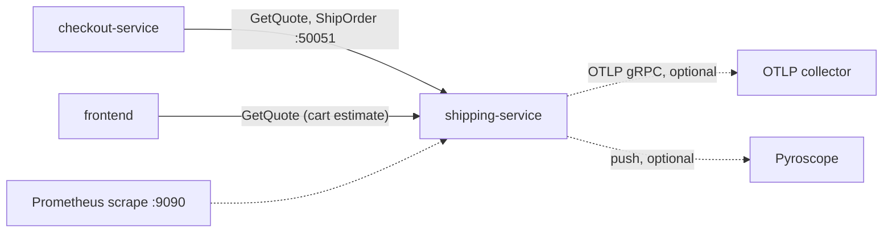
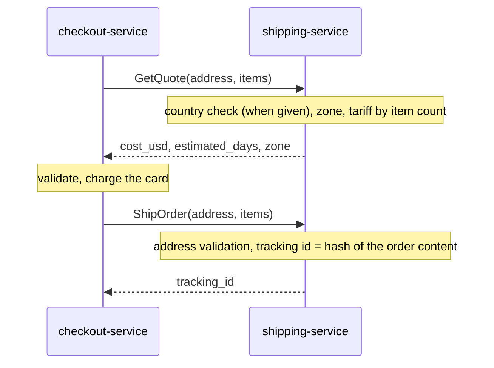

# Architecture

## Context

shipping-service is a simulation. It calls no other service and stores nothing: a quote is computed from a fixed tariff and `ShipOrder` validates the address and returns a tracking id derived from the order content. The callers are taken from the README ("Called by"); they were not re-verified in the callers' code for this page.

## Flow

The quote runs before the card is charged and `ShipOrder` after it. Because `GetQuote` already rejects a country that `ShipOrder` would reject, a bad country fails the order before the charge; a street, city or zip problem is only found by `ShipOrder` (see [Known limitations](limitations.md)).

## Components

| File | Role |
|---|---|
| `cmd/server/main.go` | listen, gRPC server with tracing, metrics and recovery interceptors, health service, reflection, drain on SIGTERM |
| `internal/shipping/service.go` | the `GetQuote` and `ShipOrder` handlers |
| `internal/shipping/quote.go` | zones, tariff table, price and `estimated_days` |
| `internal/shipping/address.go`, `countries.go` | address validation, country normalisation to the ISO code (`ResolveCountry`, shared by both RPCs) |
| `internal/shipping/tracker.go` | deterministic tracking id from the canonical order text ([ADR 1](adr/0001-deterministic-tracking-id.md)) |
| `internal/healthcheck/`, `internal/obs/` | the `healthcheck` subcommand; telemetry, logs, metrics (same package in every Go service) |

## Contracts

The proto package is `hipstershop` (legacy name, [ADR 2](adr/0002-legacy-proto-package-hipstershop.md)); changes are additive only.
